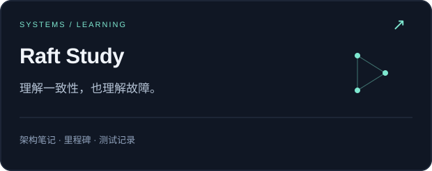
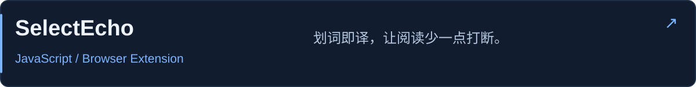
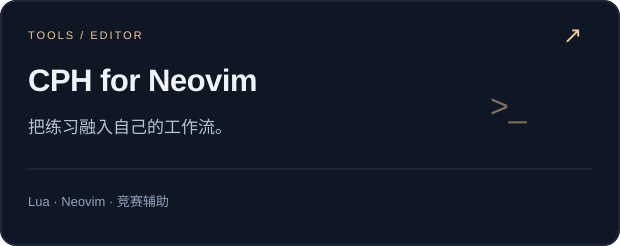
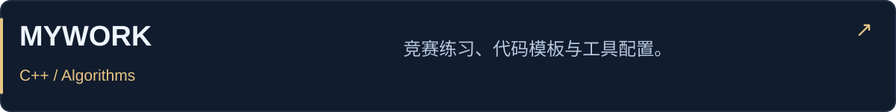
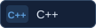

<picture><source media="(max-width: 600px)" srcset="./assets/banner-mobile.svg" /></picture>

<p align="center"><picture><source media="(max-width: 600px)" srcset="./assets/status-mobile.svg" /></picture></p>

<p align="center">
  <a href="https://alisa22580.com/"><b>数字花园</b></a> &nbsp; · &nbsp;
  <a href="https://codeforces.com/profile/alisa22580"><b>Codeforces</b></a> &nbsp; · &nbsp;
  <a href="https://github.com/2258009564?tab=repositories"><b>项目仓库</b></a>
</p>

### 👋 About

我是 **alisa22580**，软件工程学生、ACMer。以 C++ 和算法竞赛为起点，向存储与分布式基础设施深入；也用 Go、JavaScript 和 Lua 做学习实验、浏览器工具与编辑器插件。

```yaml
base:  C++ / ACM
focus: Systems & Infra
build: Notes & tools
```

### 🏆 ICPC / CCPC

| 年份 | 赛事 | 成绩 |
| :---: | --- | --- |
| 2026 | CCPC 区域赛 · 长春站 | 🥉 铜牌 |
| 2026 | ICPC 重庆省赛 | 🥇 **金牌 · Rank 12** |
| 2026 | ICPC 广西邀请赛 | 🥈 **银牌** |
| 2026 | ICPC 沈阳邀请赛 | 🥈 **银牌** |
| 2025 | CCPC 黑龙江省赛 | 🥈 **银牌** |
| 2025 | CCPC 东北赛 | 🥉 铜牌 |

#### 蓝桥杯

| 年份 | 赛事 | 成绩 |
| :---: | --- | --- |
| 2026 | 第十七届蓝桥杯全国总决赛 | **一等奖** |
| 2026 | 第十七届蓝桥杯黑龙江省赛 · C++ B 组 | **一等奖 · 黑龙江省第 2** |

### 🚀 Selected projects

<a href="https://github.com/2258009564/raft-study"><picture><source media="(max-width: 600px)" srcset="./assets/raft-mobile.svg" /></picture></a>

Raft 的中文架构笔记与阶段验收记录；公开仓库为学习文档。

<a href="https://github.com/2258009564/SelectEcho"><picture><source media="(max-width: 600px)" srcset="./assets/selectecho-mobile.svg" /></picture></a>

面向 Chrome / Edge 的划词翻译扩展，关注引擎策略与结构保真展示。

<a href="https://github.com/2258009564/cph_for_nvim"><picture><source media="(max-width: 600px)" srcset="./assets/neovim-mobile.svg" /></picture></a>

接收 Competitive Companion 题目，在 Neovim 内管理用例、运行程序与比较输出。

<a href="https://github.com/2258009564/MYWORK"><picture><source media="(max-width: 600px)" srcset="./assets/algorithms-mobile.svg" /></picture></a>

算法竞赛练习、C++ 模板与编辑器配置的积累。

### 🛠 Tech stack

**Languages**<br />
    

**Workspace**<br />
  

Windows / WSL · 算法练习 · 系统学习 · 工具开发

### 📊 Coding activity

<details>
<summary><b>展开 WakaTime 编码统计</b></summary>

<!--START_SECTION:waka-->


**🐱 My GitHub Data** 

> 📦 412.3 kB Used in GitHub's Storage 
 > 
> 🏆 175 Contributions in the Year 2026
 > 
> 💼 Opted to Hire
 > 
> 📜 18 Public Repositories 
 > 
> 🔑 2 Private Repositories 
 > 
**I'm a Night 🦉** 

```text
🌞 Morning                27 commits          █░░░░░░░░░░░░░░░░░░░░░░░░   03.85 % 
🌆 Daytime                149 commits         █████░░░░░░░░░░░░░░░░░░░░   21.26 % 
🌃 Evening                425 commits         ███████████████░░░░░░░░░░   60.63 % 
🌙 Night                  100 commits         ████░░░░░░░░░░░░░░░░░░░░░   14.27 % 
```
📅 **I'm Most Productive on Monday** 

```text
Monday                   239 commits         █████████░░░░░░░░░░░░░░░░   34.09 % 
Tuesday                  40 commits          █░░░░░░░░░░░░░░░░░░░░░░░░   05.71 % 
Wednesday                85 commits          ███░░░░░░░░░░░░░░░░░░░░░░   12.13 % 
Thursday                 37 commits          █░░░░░░░░░░░░░░░░░░░░░░░░   05.28 % 
Friday                   149 commits         █████░░░░░░░░░░░░░░░░░░░░   21.26 % 
Saturday                 75 commits          ███░░░░░░░░░░░░░░░░░░░░░░   10.70 % 
Sunday                   76 commits          ███░░░░░░░░░░░░░░░░░░░░░░   10.84 % 
```


📊 **This Week I Spent My Time On** 

```text
🕑︎ Time Zone: Asia/Shanghai

💬 Programming Languages: 
Python                   9 hrs 34 mins       ██████████░░░░░░░░░░░░░░░   39.18 % 
Other                    6 hrs 32 mins       ███████░░░░░░░░░░░░░░░░░░   26.78 % 
Markdown                 3 hrs 27 mins       ████░░░░░░░░░░░░░░░░░░░░░   14.18 % 
TeX                      1 hr 15 mins        █░░░░░░░░░░░░░░░░░░░░░░░░   05.18 % 
PowerShell               1 hr 3 mins         █░░░░░░░░░░░░░░░░░░░░░░░░   04.31 % 

🔥 Editors: 
Codex Vscode             22 hrs 24 mins      ███████████████████████░░   91.74 % 
Codex CLI                1 hr 3 mins         █░░░░░░░░░░░░░░░░░░░░░░░░   04.30 % 
VS Code                  58 mins             █░░░░░░░░░░░░░░░░░░░░░░░░   03.96 % 

🐱‍💻 Projects: 
new-chat-2               6 hrs 37 mins       ███████░░░░░░░░░░░░░░░░░░   27.16 % 
new-chat                 5 hrs 2 mins        █████░░░░░░░░░░░░░░░░░░░░   20.64 % 
wxz                      4 hrs 41 mins       █████░░░░░░░░░░░░░░░░░░░░   19.21 % 
d-desktop-raft-2026-10-063 hrs 29 mins       ████░░░░░░░░░░░░░░░░░░░░░   14.27 % 
hysteria2-2              1 hr 4 mins         █░░░░░░░░░░░░░░░░░░░░░░░░   04.37 % 

💻 Operating System: 
Windows                  24 hrs 25 mins      █████████████████████████   100.00 % 
```

🤖 **AI Coding This Week** 

```text
⏱ AI Coding Time: 23 hrs 43 mins (97.16%)

✍️ 9,315 lines written by AI, 422 lines written by hand (95.67% AI-written)

🔤 14,807,575 Input Tokens, 1,828,321 Output Tokens

💵 $131.11 Estimated AI Cost This Week

🧠 55 AI Sessions, 280 AI Prompts

GPT                      9,104 lines         ████████████████████████░   97.50 % 
Codex-Vscode             233 lines           █░░░░░░░░░░░░░░░░░░░░░░░░   02.50 % 

🔎 AI Coding Insights:
🤖 AI-Driven — 95.67% of written lines came from AI
📚 Verbose Prompter — average 3,288 characters per prompt
🔁 Iterative Prompter — average 5 prompts per session
🚀 High AI Trust — 4.65% of changed lines were hand-edited
```

**I Mostly Code in JavaScript** 

```text
JavaScript               4 repos             ██████░░░░░░░░░░░░░░░░░░░   25.00 % 
PowerShell               1 repo              ██░░░░░░░░░░░░░░░░░░░░░░░   06.25 % 
TeX                      1 repo              ██░░░░░░░░░░░░░░░░░░░░░░░   06.25 % 
Go                       1 repo              ██░░░░░░░░░░░░░░░░░░░░░░░   06.25 % 
Lua                      1 repo              ██░░░░░░░░░░░░░░░░░░░░░░░   06.25 % 
```


**Timeline**


 Last Updated on 28/10/2026 22:44:27 UTC
<!--END_SECTION:waka-->

</details>

---

<p align="center">
  <b>把问题想清楚，把系统做扎实。</b><br />
  <sub>Algorithms sharpen the mind. Systems deepen the craft.</sub>
</p>
